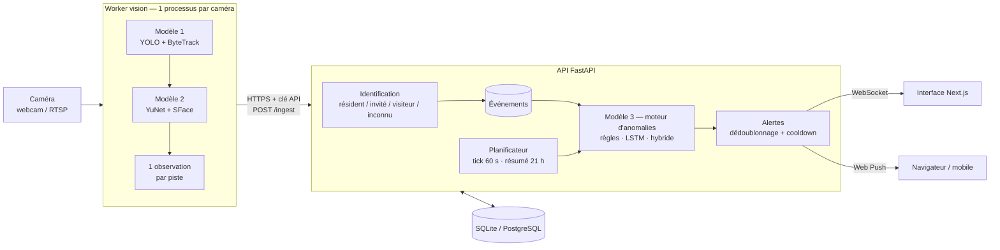

# DomicileSecure

**Assistant IA de sécurité domestique.** Il reconnaît les personnes (membres du foyer, invités, inconnus), détecte les situations anormales plutôt que le simple mouvement, et envoie des alertes utiles et un résumé quotidien en quelques lignes.

> Projet de stage — XeleronAI LTD · Elkebdani Hicham

---

## Le problème

Une caméra classique alerte à chaque mouvement : un chat qui passe, un arbre qui bouge… Au bout d'une semaine, on ignore toutes les notifications, y compris la bonne.

DomicileSecure raisonne sur **qui** est là, **quand**, et **si c'est habituel** :

| Situation | Caméra classique | DomicileSecure |
|---|---|---|
| Le chat traverse le salon | 🔔 Alerte | Journalisé, aucune alerte |
| Un membre du foyer rentre à 18 h | 🔔 Alerte | Reconnu, aucune alerte |
| Un inconnu à la porte à 3 h du matin | 🔔 Alerte (noyée dans les autres) | 🔴 Alerte **haute** + notification push |
| La porte reste ouverte 20 min, personne à la maison | Rien | 🔴 Alerte « porte restée ouverte » |
| Activité inhabituelle en pleine nuit | Rien | 🟠 Alerte du modèle LSTM |
| La même personne revient souvent | Rien | Suggestion « enregistrer comme invité » |

## Architecture



**Principe clé :** le worker *perçoit* (vidéo → observations), l'API *décide* (identité, anomalies, alertes). La vidéo ne traverse jamais le réseau ; seules des observations de quelques octets sont envoyées. Détails : [docs/architecture.md](docs/architecture.md).

## Fonctionnalités

- **Détection d'objets** (YOLO11) avec **suivi multi-objets** (ByteTrack) : une personne = un événement, pas 60 images.
- **Reconnaissance faciale** (YuNet + SFace, OpenCV) ; les photos ne sont **jamais stockées**, seules les signatures faciales le sont.
- **Profils visiteurs automatiques** : un visage inconnu qui revient est reconnu comme « visiteur », puis proposé comme invité.
- **Moteur d'anomalies interchangeable** : règles explicites (phase 1), **LSTM probabiliste** (phase 2) ou **hybride**, en changeant une seule variable (`ANOMALY_ENGINE`).
- **Alertes intelligentes** : niveaux de gravité, dédoublonnage, cooldown, retour « fausse alerte ».
- **Temps réel** (WebSocket) et **notifications push** (Web Push/VAPID), même application fermée.
- **Résumé quotidien** généré et archivé chaque soir.
- **Pipeline MLOps** : données synthétiques, export des données réelles, entraînement, évaluation comparative et artefacts versionnés.

### Résultats de l'évaluation (données synthétiques, 120 jours, 17 anomalies)

| Moteur | Anomalies détectées | Résidents actifs en pleine nuit | Fausses alertes / jour |
|---|---|---|---|
| Règles (phase 1) | 59 % | 0/7 | 0,13 |
| LSTM (phase 2) | 94 % | 7/7 | 0,05 |
| **Hybride** | **100 %** | **7/7** | 0,18 |

Méthode et limites : [docs/ml.md](docs/ml.md).

## Stack technique

| Couche | Technologies |
|---|---|
| API | Python 3.11+, FastAPI, Pydantic v2, SQLAlchemy 2 (async), Alembic, APScheduler |
| Base de données | SQLite (développement) · PostgreSQL (production) |
| Vision | Ultralytics YOLO11 + ByteTrack, OpenCV (YuNet, SFace) |
| IA temporelle | PyTorch (LSTM prévisionnel Poisson/Bernoulli) |
| Temps réel | WebSocket, Web Push (pywebpush + VAPID) |
| Frontend | Next.js 16 (App Router), React 19, TypeScript, Tailwind CSS 4, TanStack Query, Recharts |
| Qualité | pytest (79 tests, 84 % de couverture), Ruff, ESLint, TypeScript strict, GitHub Actions |
| Déploiement | systemd + Nginx + PostgreSQL, **sans Docker** |

## Démarrage rapide

Prérequis : **Python 3.11+**, **Node.js 20.9+**, Git.

### Windows (PowerShell)

```powershell
# 1. Backend
cd backend
python -m venv .venv
.\.venv\Scripts\Activate.ps1
pip install -r requirements/dev.txt -r requirements/vision.txt -r requirements/ml.txt
Copy-Item .env.example .env
python scripts/generate_secrets.py        # copier les valeurs dans .env
python scripts/download_models.py         # modèles de visage + YOLO
alembic upgrade head                       # crée la base
python scripts/seed_demo.py               # (optionnel) une semaine de données de démo
uvicorn app.main:create_app --factory --reload

# 2. Frontend (nouveau terminal)
cd frontend
Copy-Item .env.example .env.local
npm install
npm run dev
```

> Si PowerShell refuse d'activer l'environnement virtuel : `Set-ExecutionPolicy -Scope CurrentUser RemoteSigned`.

### Linux / macOS

```bash
cd backend
python3 -m venv .venv && source .venv/bin/activate
pip install -r requirements/dev.txt -r requirements/vision.txt -r requirements/ml.txt
cp .env.example .env && python scripts/generate_secrets.py
python scripts/download_models.py && alembic upgrade head
python scripts/seed_demo.py
uvicorn app.main:create_app --factory --reload

cd ../frontend && cp .env.example .env.local && npm install && npm run dev
```

Ouvrez <http://localhost:3000> et connectez-vous avec `demo@example.com` / `demo-password-123` (créé par `seed_demo.py`). La documentation interactive de l'API se trouve sur <http://localhost:8000/docs>.

### Brancher une vraie caméra

```bash
cd backend
python -m app.cli create-admin --email vous@exemple.com      # si pas de données de démo
python -m app.cli create-camera --name "Entrée" --has-door  # affiche WORKER_CAMERA_ID=...
# Renseignez WORKER_CAMERA_ID et WORKER_CAMERA_SOURCE (0 = webcam) dans .env, puis :
python -m worker
```

Enregistrez ensuite les visages du foyer depuis la page **Personnes** (5 à 10 photos par personne, avec leur accord).

## Structure du dépôt

```
DomicileSecure/
├── backend/
│   ├── app/                  # API FastAPI
│   │   ├── api/v1/routes/    #   couche HTTP (fine) : validation + appel d'un service
│   │   ├── services/         #   logique métier (identité, ingestion, alertes, résumé…)
│   │   ├── repositories/     #   seule couche qui écrit du SQL
│   │   ├── models/           #   tables SQLAlchemy
│   │   ├── schemas/          #   contrats Pydantic (entrée/sortie, contrat worker)
│   │   ├── anomaly/          #   modèle 3 : règles, LSTM, hybride (même interface)
│   │   ├── core/             #   config, sécurité, logs, erreurs, middlewares
│   │   ├── container.py      #   composition des dépendances
│   │   └── main.py           #   fabrique de l'application
│   ├── vision/               # adaptateurs modèles 1 & 2 (partagés API/worker)
│   ├── worker/               # processus caméra
│   ├── training/             # simulation, export, entraînement, évaluation
│   ├── scripts/              # modèles, secrets, données de démo
│   ├── alembic/              # migrations
│   ├── tests/                # unitaires + intégration
│   └── requirements/         # api / vision / ml / dev
├── frontend/                 # Next.js
│   └── src/{app,components,lib}
├── infra/                    # systemd, Nginx, sauvegardes (déploiement sans Docker)
├── docs/                     # architecture, API, BDD, ML, sécurité, tests, déploiement, sprints
└── .github/workflows/ci.yml  # intégration continue
```

## Documentation

| Document | Contenu |
|---|---|
| [Architecture](docs/architecture.md) | Composants, flux, choix techniques, SOLID, scalabilité, améliorations |
| [API](docs/api.md) | Endpoints, authentification, erreurs, contrat du worker, WebSocket |
| [Base de données](docs/database.md) | Schéma, index, migrations |
| [IA / MLOps](docs/ml.md) | Les 3 modèles, collecte de données, entraînement, évaluation, versionnement |
| [Sécurité](docs/security.md) | Mesures en place, données biométriques, checklist production |
| [Tests](docs/testing.md) | Stratégie, commandes, couverture |
| [Déploiement](docs/deployment.md) | Serveur Linux sans Docker (systemd + Nginx + PostgreSQL) |
| [Sprints](docs/sprints/) | Planning et comptes rendus |

## Qualité : commandes utiles

```bash
# backend
ruff check . && ruff format --check .
pytest --cov                       # 79 tests
pytest -m "not slow"               # sans l'entraînement du mini-LSTM
# frontend
npm run lint && npm run typecheck && npm run build
```

## Licences des modèles

- **YuNet / SFace** (OpenCV Zoo) : Apache-2.0, usage commercial autorisé.
- **Ultralytics YOLO** : AGPL-3.0. Adapté au stage et aux démos ; un produit commercial nécessite une licence Ultralytics ou un autre détecteur. Le changement se limite à une classe derrière l'interface `ObjectDetector`.

Code propriétaire, © XeleronAI LTD.
