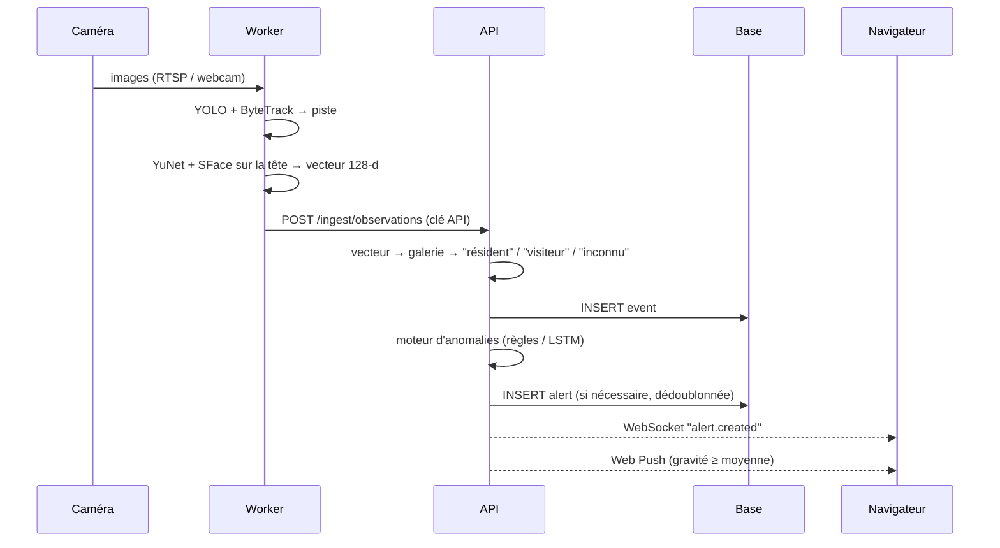

# Architecture

## 1. Vue d'ensemble

DomicileSecure est découpé en **trois processus** qui ne partagent que des contrats explicites :

| Processus | Rôle | Scalabilité |
|---|---|---|
| **Worker vision** (`backend/worker`) | Lit un flux vidéo, exécute les modèles 1 (objets) et 2 (visages), envoie des *observations* | 1 processus par caméra, sur n'importe quelle machine du réseau |
| **API** (`backend/app`) | Identifie, enregistre, détecte les anomalies (modèle 3), alerte, résume | Sans état (hors cache mémoire) ; voir § 6 |
| **Frontend** (`frontend`) | Tableau de bord, gestion des personnes et caméras, alertes en temps réel | Statique + Node, derrière Nginx |



## 2. Pourquoi cette séparation « percevoir / décider » ?

- **Aucune inférence dans une requête HTTP.** La vision est lourde (CPU/GPU). Elle tourne dans le worker, jamais dans l'API, qui garde des temps de réponse de quelques millisecondes.
- **La vidéo ne circule pas.** Le worker envoie quelques centaines d'octets par piste, pas des images. Cela réduit la bande passante et les risques pour la vie privée.
- **Une piste = une observation.** Le `TrackAggregator` suit chaque identifiant ByteTrack et garde le meilleur visage sur quelques images. Il envoie ensuite **un seul** message. Résultat : pas de rafales d'alertes, et une table `events` propre qui sert directement de données d'entraînement au LSTM.
- **L'identification se fait côté API** (produit matriciel sur la galerie en mémoire). Le worker n'a ni base de données ni données personnelles de référence. Un worker compromis ne donne accès à aucune identité.
- **Tolérance aux pannes.** Si l'API redémarre, le worker met les observations en mémoire tampon (bornée) et réessaie. Si le LSTM ne se charge pas, l'API retombe sur les règles et journalise une erreur au lieu de s'arrêter.

## 3. Couches de l'API

```
routes (HTTP)  →  services (métier)  →  repositories (SQL)  →  models (tables)
                         ↓
               anomaly / vision (interfaces)
```

| Couche | Responsabilité | Ne fait jamais |
|---|---|---|
| `api/v1/routes` | Valider l'entrée (Pydantic), vérifier les droits, appeler un service | Du SQL, de la logique métier |
| `services` | Règles métier, transactions (`commit`), notifications *après* commit | Connaître HTTP (lèvent des `AppError`) |
| `repositories` | Construire les requêtes SQLAlchemy | Décider quoi que ce soit |
| `anomaly` | Détecteurs purs : contexte en entrée, `Finding` en sortie | Des entrées/sorties (ni BDD, ni réseau) |
| `core` | Configuration, sécurité, logs, erreurs, middlewares | — |

Les exceptions métier (`NotFoundError`, `ConflictError`…) sont traduites en un **format d'erreur unique** par `core/exceptions.py` :

```json
{"error": {"code": "not_found", "message": "Caméra introuvable", "details": {}}}
```

## 4. Principes SOLID appliqués

| Principe | Où | Comment |
|---|---|---|
| **S**ingle responsibility | `IdentityService`, `AlertService`, `IngestService`… | Chaque service a une seule raison de changer ; `IngestService` orchestre les autres |
| **O**pen/closed | `app/anomaly/rules/` | Ajouter une règle = ajouter une classe `EventRule`/`TickRule`, sans toucher au moteur |
| **L**iskov | `AnomalyDetector` | `RuleBasedDetector`, `LSTMAnomalyDetector` et `HybridDetector` sont interchangeables |
| **I**nterface segregation | `EventRule` vs `TickRule`, `NotificationChannel` | Des interfaces petites et ciblées |
| **D**ependency inversion | `container.py` | Les services dépendent d'abstractions (`FaceEmbedder`, `ObjectDetector`, `NotificationChannel`) ; les implémentations concrètes sont choisies dans le *composition root*. Les tests injectent des faux |

## 5. Choix techniques et alternatives écartées

| Décision | Choix | Pourquoi | Alternatives écartées |
|---|---|---|---|
| Framework API | FastAPI | Async natif, validation Pydantic, OpenAPI automatique, WebSocket | Flask (sync, validation manuelle) |
| ORM | SQLAlchemy 2 async + Alembic | Standard de l'industrie, migrations reproductibles, SQLite ↔ PostgreSQL sans changer le code | SQLModel (moins mature pour les migrations) |
| Identifiants | UUID | Non devinables, générables côté client, fusion de bases possible | Entiers auto-incrémentés |
| Dates | `UTCDateTime` (toujours UTC, *timezone-aware*) | Évite les bugs de fuseau et de changement d'heure ; le fuseau du foyer n'intervient qu'à l'affichage et dans les règles | `DateTime` naïf |
| Détection | YOLO11n + ByteTrack | Temps réel sur CPU, suivi intégré | Détection seule (doublons), Faster R-CNN (lent) |
| Visages | YuNet + SFace (OpenCV) | `pip install` sans compilation sous Windows, Apache-2.0, 99,4 % sur LFW | InsightFace (compilation C++ et modèles non commerciaux), dlib (compilation) |
| Anomalies phase 2 | **LSTM prévisionnel probabiliste** | Voir [ml.md](ml.md) : un autoencodeur recopie les anomalies ; la MSE noie les événements rares | LSTM autoencodeur (testé, rejeté) |
| Temps réel | WebSocket, authentifié par le premier message | Pas de jeton dans l'URL (qui finirait dans les logs) | SSE (unidirectionnel mais suffisant), polling |
| Push | Web Push standard (VAPID) | Aucun service tiers, fonctionne sur Chrome, Firefox, Edge et Safari | Firebase (dépendance Google) |
| Frontend | Next.js App Router + TanStack Query | Cache, invalidation ciblée par les messages WebSocket | Redux (plus de code pour le même résultat) |
| Conteneurs | **Aucun** (demande du projet) | systemd + venv + `output: standalone` couvrent le besoin | Docker |

## 6. Scalabilité et évolution

| Charge | Configuration |
|---|---|
| 1 foyer, 1 à 4 caméras (cible du stage) | 1 API + SQLite ou PostgreSQL, workers sur la même machine |
| Plusieurs caméras, machine dédiée | PostgreSQL, workers répartis sur des mini-PC près des caméras, GPU optionnel (`WORKER_DEVICE=cuda:0`) |
| Plusieurs instances d'API | Remplacer `RealtimeHub` et `SlidingWindowRateLimiter` par Redis (même interface), activer le planificateur sur **une seule** instance (`SCHEDULER_ENABLED`) |
| Milliers de visages | Remplacer `FaceGallery` par pgvector ou FAISS (même méthode `match`) |
| Multi-foyers (SaaS) | Ajouter `household_id` sur chaque table et le filtrer dans les repositories |

## 7. Améliorations possibles (roadmap)

**Court terme (stage)**
- [ ] Entraîner le détecteur de porte sur la vraie porte (`training/finetune_door.py`).
- [ ] Réentraîner le LSTM sur les événements réels exportés (`training/export_events.py`).
- [ ] Utiliser les « fausses alertes » signalées pour ajuster les seuils.
- [ ] Captures d'écran (vignette floutée) jointes aux alertes importantes.

**Moyen terme**
- [ ] Authentification par cookie `httpOnly` + jeton de rafraîchissement.
- [ ] Fusion manuelle de deux profils (« Visiteur A » = « Visiteur B »).
- [ ] Zones d'intérêt par caméra (ignorer la rue, surveiller l'allée).
- [ ] Mode « absence / vacances » qui durcit les règles.
- [ ] Résumé quotidien reformulé par un LLM (interface `SummaryWriter` déjà prête).
- [ ] Métriques Prometheus (latence d'ingestion, alertes par règle, file du worker).

**Long terme**
- [ ] Inférence embarquée (Jetson, Raspberry Pi + Hailo) avec des modèles exportés en ONNX/TensorRT.
- [ ] Application mobile (PWA installable : service worker déjà en place).
- [ ] Détecteur sous licence permissive pour une commercialisation (RT-DETR Apache-2.0…).
