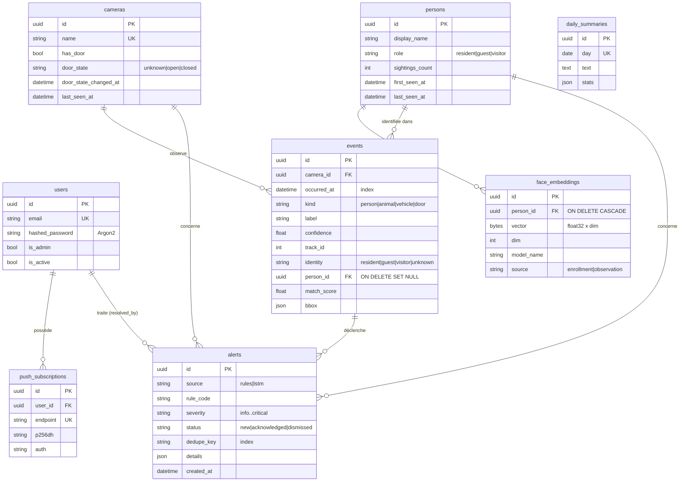

# Base de données

SQLite en développement (aucune installation), PostgreSQL en production. Le code est identique : seule `DATABASE_URL` change.

## Schéma



## Choix de modélisation

- **Pas de photos en base.** `face_embeddings.vector` contient 128 flottants (512 octets). Une signature ne permet pas de reconstruire le visage.
- **Pas d'URL RTSP en base.** Les identifiants de caméra restent dans le `.env` du worker.
- **`model_name` sur chaque signature.** Changer de modèle de reconnaissance ne mélange jamais des vecteurs incompatibles : la galerie les sépare par modèle.
- **Enums stockés par valeur** (`"open"`, pas `"OPEN"`) et en `VARCHAR` (`native_enum=False`) : lisibles dans les exports et portables SQLite ↔ PostgreSQL.
- **Toutes les dates en UTC**, via le type `UTCDateTime` qui refuse les dates naïves.
- **Index** sur les requêtes chaudes : `events(camera_id, occurred_at)`, `events(kind, occurred_at)`, `alerts(dedupe_key, created_at)` (dédoublonnage), `alerts(status)`, `persons(role)`.
- **Contraintes nommées** (convention de nommage) : migrations reproductibles d'une base à l'autre.

## Migrations (Alembic)

```bash
alembic upgrade head                                    # appliquer
alembic revision --autogenerate -m "add camera zones"   # après modification d'un modèle
alembic downgrade -1                                    # annuler la dernière
alembic check                                           # vérifier que modèles et migrations sont alignés (utilisé en CI)
```

Relisez toujours une migration générée avant de la committer. Pour SQLite, Alembic utilise le mode *batch*, qui recrée la table pour les `ALTER`.

## Rétention (recommandation)

| Table | Conservation conseillée |
|---|---|
| `events` | 90 jours (au-delà, exporter en CSV pour l'entraînement puis purger) |
| `alerts` | 1 an |
| `face_embeddings` des visiteurs jamais identifiés | 30 jours |

La purge automatique fait partie de la roadmap. Elle est importante pour la conformité RGPD (minimisation des données).
