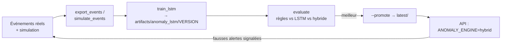

# IA et MLOps

DomicileSecure enchaîne **trois modèles**. Chacun est derrière une interface, ce qui permet de le remplacer sans toucher au reste.

| # | Rôle | Implémentation | Interface | Où il tourne |
|---|---|---|---|---|
| 1 | Détecter et suivre personnes, animaux, véhicules, état de la porte | YOLO11n (COCO) + ByteTrack ; YOLO fine-tuné pour la porte | `vision.detection.ObjectDetector` | Worker |
| 2 | Transformer un visage en signature et l'identifier | YuNet (détection) + SFace (vecteur 128-d) ; galerie cosinus | `vision.face.FaceEmbedder` + `FaceGallery` | Worker (vecteur) + API (identification) |
| 3 | Décider si la situation est anormale | Règles → LSTM probabiliste → hybride | `app.anomaly.AnomalyDetector` | API |

---

## Modèle 1 — Détection d'objets

- **Pré-entraîné sur COCO** : `person`, `cat`, `dog`, `car`… sont reconnus sans aucune donnée à collecter.
- **ByteTrack** attribue un identifiant stable à chaque objet. Le `TrackAggregator` n'émet qu'**une observation par piste**.
- **Porte ouverte/fermée** : COCO ne connaît pas ces classes, il faut fine-tuner :
  1. Filmer **votre** porte (jour, nuit, lumière allumée ou éteinte, quelqu'un devant) : 200 à 500 images.
  2. Annoter avec Roboflow, CVAT ou Label Studio (classes `door_open`, `door_closed`), puis exporter au format YOLO dans `backend/data/door/`.
  3. Lancer `python -m training.finetune_door --data data/door/data.yaml`.
  4. Définir `WORKER_DOOR_MODEL_PATH=artifacts/vision/door_yolo.pt`.
- Un **debouncer** (5 images consécutives) filtre les erreurs ponctuelles (quelqu'un passe devant la porte).
- Pour tester sans caméra, utilisez des vidéos libres de droits (Pexels, Pixabay) : `WORKER_CAMERA_SOURCE=chemin/video.mp4`.

## Modèle 2 — Reconnaissance faciale

- **Enrôlement** : 5 à 10 photos par personne via la page **Personnes**. L'API refuse les photos sans visage, avec plusieurs visages ou floues.
- **Identification** : similarité cosinus entre le vecteur observé et la galerie ; seuil `FACE_MATCH_THRESHOLD=0.363` (valeur de référence SFace). Augmentez-le pour réduire les confusions, diminuez-le si les membres du foyer ne sont pas reconnus.
- **Visiteurs automatiques** : un visage non reconnu crée un profil « Visiteur XXXX ». S'il revient (passages espacés de plus de `SIGHTING_GAP_MINUTES`), il est reconnu comme visiteur. Au bout de `RECURRING_VISITOR_THRESHOLD` passages, une suggestion « l'enregistrer comme invité ? » est émise.
- **Évaluation hors ligne** : le jeu public **LFW** (*Labeled Faces in the Wild*) permet de mesurer le taux de faux acceptés et de faux rejets en fonction du seuil.

## Modèle 3 — Moteur d'anomalies

### Phase 1 : règles explicites (`app/anomaly/rules/`)

| Règle | Déclencheur | Gravité |
|---|---|---|
| `unknown_person_night` | Personne non reconnue entre 23 h et 6 h | Haute |
| `unknown_person_away` | Personne non reconnue, aucun résident vu depuis 30 min | Moyenne |
| `unknown_person_home` | Personne non reconnue, un résident est présent | Faible |
| `door_opened_night` | Ouverture de porte la nuit | Moyenne (haute si personne à la maison) |
| `door_left_open` | Porte ouverte plus de `DOOR_OPEN_MAX_SECONDS` | Moyenne (haute si personne à la maison ou la nuit) |
| `recurring_visitor` | Visiteur vu N fois | Info (suggestion) |

Les seuils sont dans `.env`. Pour ajouter une règle, créez une classe `EventRule` ou `TickRule` et ajoutez-la dans `engine.py`.

### Phase 2 : LSTM probabiliste (`app/anomaly/lstm/`)

**Données** : l'historique est découpé en fenêtres de 5 minutes. Chaque fenêtre contient 11 variables : nombres de résidents, invités, visiteurs, inconnus, animaux et véhicules, porte ouverte (0/1), heure et jour de la semaine encodés en sin/cos. Le code (`app/anomaly/features.py`) est **le même** à l'entraînement et en production, pour éviter tout décalage entre les deux.

**Modèle** : à chaque pas, le LSTM reçoit l'activité de la fenêtre précédente et le contexte calendaire de la fenêtre courante. Il prédit :
- un **taux attendu** (loi de Poisson) pour chaque comptage ;
- une **probabilité** (loi de Bernoulli) pour la porte ouverte.

**Score** : la « surprise », c'est-à-dire la log-vraisemblance négative de ce qui a été observé, moyennée sur les 3 dernières fenêtres (15 min). Voir quelqu'un à 3 h du matin, là où le taux attendu est presque nul, est très surprenant ; un résident à 19 h ne l'est pas.

**Seuil** : choisi pour un nombre cible de fausses alertes par jour (`--false-alerts-per-day 0.2`), plus parlant qu'un percentile.

#### Pourquoi ce modèle et pas un autoencodeur ? (démarche documentée)

| Essai | Résultat | Diagnostic |
|---|---|---|
| LSTM **autoencodeur** + MSE | Rate 7/7 « résidents actifs la nuit », 1,2 fausse alerte/jour | L'autoencodeur *voit* la fenêtre qu'il reconstruit : il apprend à la recopier, anomalie comprise |
| LSTM **prévisionnel** + MSE | Rappel 12 %, prédit « zéro partout » | Les événements sont des comptages rares : la MSE les noie |
| LSTM **prévisionnel probabiliste** (Poisson/Bernoulli) | **Rappel 94 %, 7/7 anomalies nocturnes, 0,05 fausse alerte/jour** | Adapté à des comptages rares et conditionné par l'heure |

### Phase 3 : hybride (recommandé)

`ANOMALY_ENGINE=hybrid` combine les deux : les règles couvrent les cas critiques et explicables (intrus la nuit, porte ouverte), le LSTM couvre « ce qui n'est pas habituel pour **ce** foyer ».

### Évaluation comparative

`python -m training.evaluate` rejoue l'historique à travers **les mêmes classes que l'API** : on mesure donc le code de production, pas une réimplémentation. Résultats sur 120 jours simulés avec 17 anomalies injectées (`seed=42`) :

| Moteur | Rappel | Porte restée ouverte | Intrus la nuit | Résident actif la nuit | Groupe d'inconnus | Fausses alertes / jour |
|---|---|---|---|---|---|---|
| Règles | 59 % | 1/1 | 6/6 | 0/7 | 3/3 | 0,13 |
| LSTM | 94 % | 0/1 | 6/6 | 7/7 | 3/3 | 0,05 |
| **Hybride** | **100 %** | 1/1 | 6/6 | 7/7 | 3/3 | 0,18 |

Le délai médian de détection du LSTM est d'environ 5 minutes, contre environ 0 pour les règles, qui réagissent à l'événement lui-même.

> **Limites** : ces chiffres portent sur des données **synthétiques**. Ils valident la méthode et le code, pas la performance réelle. Il faudra réentraîner et réévaluer sur les événements réels du foyer.

## Collecte des données : récapitulatif

| Modèle | Source | Volume | Outil |
|---|---|---|---|
| 1 — objets | COCO pré-entraîné | — | Ultralytics |
| 1 — porte | Photos/vidéos de votre porte | 200 à 500 images | Roboflow, CVAT, Label Studio |
| 2 — visages | Photos des membres, **avec consentement** | 5 à 10 par personne | Page Personnes |
| 2 — évaluation | LFW (public) | — | — |
| 3 — LSTM | `training.simulate_events` (synthétique) | 120 jours et plus | Script fourni |
| 3 — LSTM | `training.export_events` (réel) | Quelques semaines de routine | Script fourni |
| 3 — retours | Alertes marquées « fausse alerte » | Au fil de l'eau | Page Alertes |

## Cycle MLOps



```bash
cd backend
python -m training.simulate_events --days 120 --out data/synthetic
python -m training.train_lstm --events data/synthetic/events.csv --anomalies data/synthetic/anomalies.csv
python -m training.evaluate --events data/synthetic/events.csv --anomalies data/synthetic/anomalies.csv \
       --model-dir artifacts/anomaly_lstm/<VERSION> --report data/reports/evaluation.json
python -m training.train_lstm ... --promote        # une fois satisfait
```

- **Versionnement** : un dossier par version (`model.pt` et `metadata.json`). Les métadonnées contiennent les variables, le seuil, les métriques, les hyperparamètres, l'empreinte SHA-256 des données et la période couverte.
- **Chargement sûr** : `torch.load(weights_only=True)`, qui charge des poids et jamais du code.
- **Rollback** : copier une ancienne version sur `latest/` puis redémarrer l'API.
- **Résilience** : si le modèle manque ou est incompatible, l'API retombe sur les règles et journalise l'erreur.
- **Reproductibilité** : graine fixe, découpage chronologique (pas de fuite du futur), normalisation ajustée sur les données d'entraînement uniquement.
